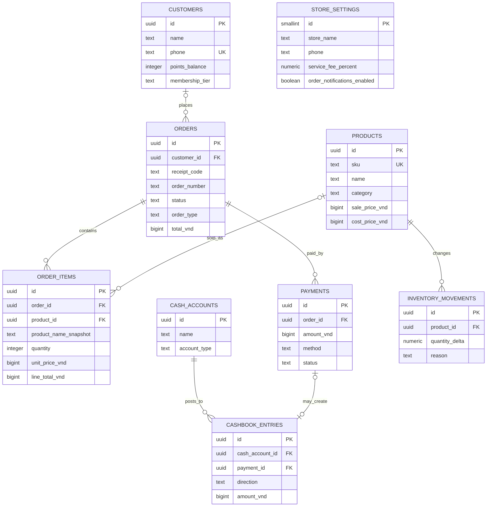

# ERD

## Relationship notes

- `store_settings` contains the single store's settings. Orders, cash accounts, cashbook entries, and inventory are scoped to that store; order and reference identifiers are unique across it.
- An order can be walk-in (no customer) or linked to one customer. It can have multiple line snapshots and payment attempts/settlements. The schema preserves snapshots, while preventing edits to closed sales remains an application permission/transaction rule.
- An order line may retain its name and price snapshot after a product is removed; its optional product reference is cleared on product deletion.
- A payment can produce at most one linked cashbook entry. The link is optional because the UI does not show reconciliation for every payment. Cashbook entries can also be manual receipts or expenses.
- Inventory movements are signed product quantity changes. Current stock is the sum of movements by product; negative totals are allowed because the UI displays negative stock.
- Customer visit count and spend are derived from orders rather than duplicated counters. The visible points balance and membership tier are stored, but the app does not implement their earning/redemption rules.

The schema deliberately has no ingredient, recipe, supplier, or waste tables. The UI exposes an ingredients display backed by an always-empty array, but does not edit ingredient quantities, receive stock, or record spoilage. See [design decisions](DESIGN_DECISIONS.md).
